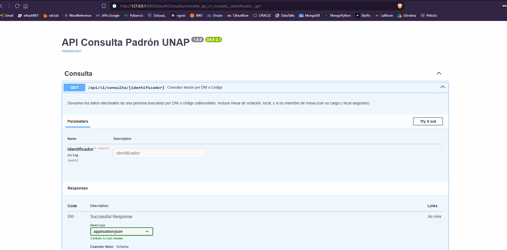

# API Consulta Electoral UNAP — Benchmark de Arquitecturas
**Business Intelligence · Actividad N° 1 | Universidad Arturo Prat**



Benchmark comparativo de tres arquitecturas de API/ingesta sobre el padrón electoral UNAP (26,665 electores). Stack: FastAPI + PostgreSQL 17 + Redis 7 (Podman).

Informe técnico: [`informe.md`](./informe.md)

---

## Arquitecturas

### 1. API Tradicional — `GET /api/v1/tradicional/{dni}`

```
Cliente → FastAPI → SELECT padron → INSERT log_consultas → Respuesta
                    (PostgreSQL, síncrono y bloqueante)
```

Consulta y escribe en la misma transacción HTTP. Bajo alta concurrencia satura el connection pool → HTTP 500.

**Respuesta:**
```json
{
  "arquitectura": "1. API Tradicional (Sincrona Bloqueante)",
  "dni": "12345678",
  "encontrado": true,
  "nombre": "GARCIA QUISPE JUAN",
  "local_votacion": "PABELLÓN A - SALA 3",
  "latencia_ms": 14.32
}
```

---

### 2. Lambda — `GET /api/v1/lambda/{dni}`

```
Cliente → FastAPI → SELECT padron → Respuesta inmediata
                         ↓ (BackgroundTask, no bloquea)
                    Speed Layer (cola en memoria)
                         ↓ (cada 100 eventos)
                    INSERT bulk → PostgreSQL
```

La escritura del log se desacopla de la respuesta HTTP. Reduce latencia, pero el Speed Layer comparte el pool de conexiones.

**Respuesta:**
```json
{
  "arquitectura": "2. Arquitectura Lambda",
  "dni": "12345678",
  "encontrado": true,
  "nombre": "GARCIA QUISPE JUAN",
  "latencia_ms": 8.71
}
```

---

### 3. Kappa — `GET /api/v1/kappa/{dni}`

```
Cliente → FastAPI → GET elector:{dni} Redis → Respuesta inmediata
                         ↓ (cache miss)
                    SELECT PostgreSQL → SET Redis (TTL 1h)
                         ↓
                    RPUSH stream:consultas (Redis)
                         ↓
                    Kappa Worker (daemon)
                         ↓
                    LPOP 250 eventos → INSERT bulk PostgreSQL
```

Lectura desde Redis (sub-ms). Escritura totalmente desacoplada vía stream Redis. Redis actúa como Serving Layer y Event Broker.

**Respuesta:**
```json
{
  "arquitectura": "3. Arquitectura Kappa (Streaming Puro con Redis)",
  "dni": "12345678",
  "encontrado": true,
  "nombre": "GARCIA QUISPE JUAN",
  "motor_streaming": "Redis en Podman",
  "latencia_ms": 2.14
}
```

---

## Resultados del Benchmark (Locust, 2 min)

| Métrica | Tradicional | Lambda | Kappa |
|---|---|---|---|
| RPS @ 50u | 62.3 | 68.7 | 67.2 |
| p50 @ 50u | 140ms | 130ms | 140ms |
| Errores @ 200u | 1.76% | 2.06% | **0.00%** |
| p50 @ 200u | 1,000ms | 1,000ms | **880ms** |
| RPS @ 200u | 11.4 | 11.8 | **13.7** |

---

## Ejecución

### 1. Levantar Redis (Podman)

```bash
podman machine init && podman machine start   # solo Windows/macOS, una vez
podman run -d --name redis-unap -p 6379:6379 redis:7-alpine
```

### 2. Levantar la API

```bash
cd back
uv sync
uv run uvicorn app.main:app --port 8000 --reload
# Swagger UI: http://localhost:8000/docs
```

### 3. Benchmark con Locust

```bash
# Modo visual → http://localhost:8089
uv run locust -f locustfile.py --host=http://127.0.0.1:8000

# Headless — 50 usuarios, 2 min
uv run locust -f locustfile.py --host=http://127.0.0.1:8000 \
  --headless -u 50 -r 10 --run-time 2m --csv=results/results_50u

# Headless — 200 usuarios (stress)
uv run locust -f locustfile.py --host=http://127.0.0.1:8000 \
  --headless -u 200 -r 20 --run-time 2m --csv=results/results_200u
```

### 4. Stack completo con Podman Compose

```bash
git clone https://github.com/dairxp/api-consulta-una.git
cd api-consulta-una
podman compose up --build -d
```

---

## Estructura

```
api-consulta-una/
├── back/
│   ├── app/
│   │   ├── main.py
│   │   ├── database.py
│   │   ├── models.py
│   │   └── routers/benchmark.py   # Las 3 arquitecturas
│   ├── locustfile.py
│   ├── dnis_test.csv
│   └── results/                   # CSVs Locust (excluidos de git)
├── schema.sql                     # DDL + 4 registros anónimos
├── docker-compose.yml
├── informe.md
└── .gitignore
```

> **Privacidad:** Los 26,665 registros reales nunca se suben a GitHub. Solo `schema.sql` con datos anónimos de ejemplo.

---

## Referencias

1. Kreps, J. (2014). *Questioning the Lambda Architecture*. O'Reilly. https://www.oreilly.com/radar/questioning-the-lambda-architecture/
2. Marz, N. & Warren, J. (2015). *Big Data*. Manning. ISBN: 978-1617290343.
3. Villamizar, M. et al. (2015). *Evaluating Monolithic vs. Microservice Architecture*. IEEE 10CCC. DOI: [10.1109/COLUMBIANCC.2015.7333476](https://doi.org/10.1109/COLUMBIANCC.2015.7333476)
4. Jamshidi, P. et al. (2018). *Microservices: The Journey So Far*. IEEE Software, 35(3). DOI: [10.1109/MS.2018.2141039](https://doi.org/10.1109/MS.2018.2141039)
5. Kleppmann, M. (2017). *Designing Data-Intensive Applications*. O'Reilly. https://dataintensive.net/
